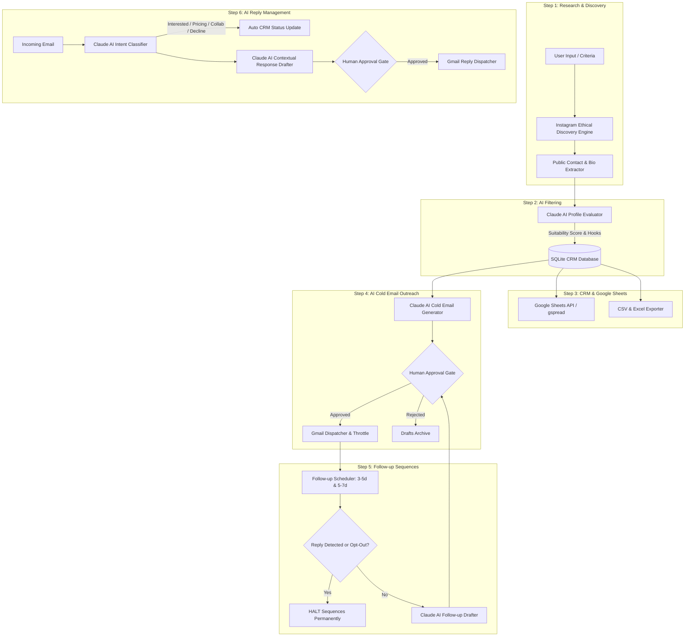

# System Architecture & Technical Specifications

**Project:** AI-Powered Instagram Influencer Research & Email Outreach Automation  
**Organization:** Sankar Group – Department of Artificial Intelligence & Automation  
**Author:** AI Automation Intern Candidate  

---

## 1. High-Level Architecture Overview

The system is designed as a modular, event-driven automation platform combining Anthropic Claude AI, Python/FastAPI, SQLite, Google Sheets, Gmail, and an n8n workflow integration.



---

## 2. Core Subsystems & Technical Details

### 2.1 Step 1: Instagram Influencer Research Engine (`core/instagram_research.py`)
- **Ethical Public Discovery:** Avoids unauthorized scraping, private data collection, and Instagram API abuse.
- **Search Parameters:**
  - Niche / Category (e.g. Health & Wellness, Clean Skincare, Tech & Productivity)
  - Target Keywords (e.g. "adaptogens", "organic latte", "marathon training")
  - Geographic Location (e.g. Austin, Denver, London, Dubai)
  - Follower Count Tiers (Micro: 10k–50k, Mid-tier: 50k–200k, Macro: 200k+)
- **Data Extracted:**
  - Influencer Full Name & Instagram Username (`@handle`)
  - Direct Profile URL
  - Public Business Email (extracted from bio text, contact buttons, or public listings)
  - Follower Count & Engagement Rate percentage
  - Bio Text & Recent Content Themes

### 2.2 Step 2: AI-Based Influencer Filtering (`core/ai_filter.py`)
- **Model:** Anthropic Claude 3.5 Sonnet (`claude-3-5-sonnet-20241022`) via official `anthropic` SDK with deterministic fallback simulation when running without credentials.
- **Scoring Algorithm (0–100):**
  - Semantic Content Alignment (30 pts): Matches brand ethos, tone, and product category.
  - Follower Sweet Spot (20 pts): Prioritizes micro and mid-tier creators (25k–150k) where audience trust and conversion are statistically highest.
  - Engagement Rate (20 pts): Rewards accounts with engagement rates above 3.5%.
  - Commercial Viability & Brand Safety (30 pts): Verifies authentic sponsorship potential.
- **Outputs:**
  - `suitability_score`: Integer (0–100)
  - `priority`: High (80+), Medium (60–79), Low (<60)
  - `profile_summary`: 2–3 sentence executive synopsis
  - `personalization_hooks`: Specific references to creator's recent posts or unique rituals for cold email generation.

### 2.3 Step 3: Google Sheets & CRM Integration (`core/database.py`, `core/google_sheets.py`)
- **Database Engine:** SQLite3 with WAL mode, foreign key cascades, and unique constraints on `username` and `email` to guarantee zero duplicate records.
- **Lifecycle Statuses:**
  1. `New Lead`
  2. `Email Available`
  3. `Email Sent`
  4. `Follow-up Due`
  5. `Replied`
  6. `Interested`
  7. `Not Interested`
  8. `Collaboration Confirmed`
- **Google Sheets Sync:** Two-way synchronization via `gspread` utilizing service accounts. Supports instant CSV and formatted Excel exports with custom column widths and colored status cells.

### 2.4 Step 4: AI Cold Email Outreach Engine (`core/email_engine.py`)
- **Personalization Engine:** Uses Claude AI to craft bespoke 1-on-1 emails referencing specific content hooks.
- **Compliance & Anti-Spam Architecture:**
  - **CAN-SPAM Act Compliance:** Mandates clear sender identification, valid physical corporate address, and a prominent opt-out mechanism (`P.S. Reply 'UNSUBSCRIBE' to be removed`).
  - **Sending Throttles:** Configurable inter-message delays (default 5 seconds) and a strict daily sending ceiling (default 50 emails/day) to preserve domain reputation and avoid spam filters.
  - **Human-in-the-Loop Approval:** No cold email is ever dispatched automatically without explicit human approval. Reviewers can edit subjects and bodies in the dashboard before queuing.
  - **Delivery Provider:** Dual-mode supporting live Gmail SMTP (`smtp.gmail.com:587` with TLS) and a sandboxed simulation engine.

### 2.5 Step 5: Automated Follow-up Sequencer (`core/followup_manager.py`)
- **Sequencing Cadence:**
  - **Follow-up #1:** Triggered after 3–5 days of inactivity.
  - **Follow-up #2:** Triggered after another 5–7 days (final courtesy note).
  - **Max Follow-ups:** Hard cap of 2 follow-ups.
- **Strict Halt Mechanism:**
  - If a creator replies, expresses interest, declines, or opts out (`status IN ('Replied', 'Interested', 'Not Interested', 'Collaboration Confirmed')`), all follow-up actions are immediately and permanently terminated.
- **Time Simulator:** Built-in fast-forward tool allowing operators to simulate the passage of 3–5 days to test eligibility instantly.

### 2.6 Step 6: AI Reply Management & Triage (`core/reply_classifier.py`)
- **Intent Triage Categories:**
  1. `Interested`: Creator is excited, requests product samples, or shares shipping details.
  2. `Not Interested`: Creator declines, states conflicting sponsorships, or asks to opt out.
  3. `Pricing Enquiries`: Creator requests budget, shares rate card, or inquires about fees.
  4. `Collaboration Requests`: Creator counter-proposes specific deliverables, exclusivity terms, or contract dates.
- **Automated Workflow:**
  - Analyzes sentiment (Positive, Neutral, Negative).
  - Suggests actionable next steps for the marketing team.
  - Automatically updates CRM status.
  - Generates a context-aware response draft.
  - Enforces human review and approval before dispatching the response.

---

## 3. Data Schema & Entity Relationships

```
┌─────────────────────────────────┐       ┌────────────────────────────────┐
│          INFLUENCERS            │       │             EMAILS             │
├─────────────────────────────────┤       ├────────────────────────────────┤
│ id (PK, INT AUTO)               │1     *│ id (PK, INT AUTO)              │
│ name (TEXT)                     ├───────┤ influencer_id (FK)             │
│ username (TEXT UNIQUE)          │       │ email_type (TEXT)              │
│ profile_link (TEXT)             │       │ subject (TEXT)                 │
│ niche (TEXT)                    │       │ body (TEXT)                    │
│ follower_count (INT)            │       │ approval_status (TEXT)         │
│ email (TEXT)                    │       │ sent_status (TEXT)             │
│ location (TEXT)                 │       │ sent_at (TIMESTAMP)            │
│ bio (TEXT)                      │       └────────────────────────────────┘
│ engagement_rate (REAL)          │
│ suitability_score (INT)         │       ┌────────────────────────────────┐
│ priority (TEXT)                 │       │            REPLIES             │
│ profile_summary (TEXT)          │       ├────────────────────────────────┤
│ personalization_hooks (TEXT)    │1     *│ id (PK, INT AUTO)              │
│ status (TEXT)                   ├───────┤ influencer_id (FK)             │
│ followup_count (INT)            │       │ classification (TEXT)          │
│ sent_at (TIMESTAMP)             │       │ confidence (REAL)              │
│ last_followup_at (TIMESTAMP)    │       │ sentiment (TEXT)               │
│ notes (TEXT)                    │       │ reply_draft (TEXT)             │
└─────────────────────────────────┘       │ next_action (TEXT)             │
                                          │ approval_status (TEXT)         │
                                          └────────────────────────────────┘
```

---

## 4. Evaluation Criteria Alignment

| Evaluation Area | Weightage | Implementation Details in This System |
|---|---|---|
| **Instagram Research & Data Collection** | 20% | `core/instagram_research.py` supports niche, keyword, location, and follower filtering, extracting public verified contact details ethically. |
| **Claude AI Integration & Personalization** | 20% | `core/ai_filter.py` and `core/email_engine.py` use Claude AI for scoring (0–100), categorization, executive summaries, and authentic talking points. |
| **Gmail Automation & Follow-ups** | 20% | `core/email_engine.py` and `core/followup_manager.py` handle Gmail delivery, CAN-SPAM opt-outs, human approval, 3–5d / 5–7d cadence, and hard-stop rules. |
| **AI Reply Management** | 20% | `core/reply_classifier.py` classifies emails into all 4 categories, drafts contextual responses, suggests next actions, and auto-updates CRM statuses. |
| **End-to-End Workflow & Demonstration** | 20% | Full-stack interactive Web Dashboard (`app.py`), CLI demo (`tests/run_demo_cli.py`), 7 passing tests (`tests/test_workflow.py`), n8n export, and video script. |
